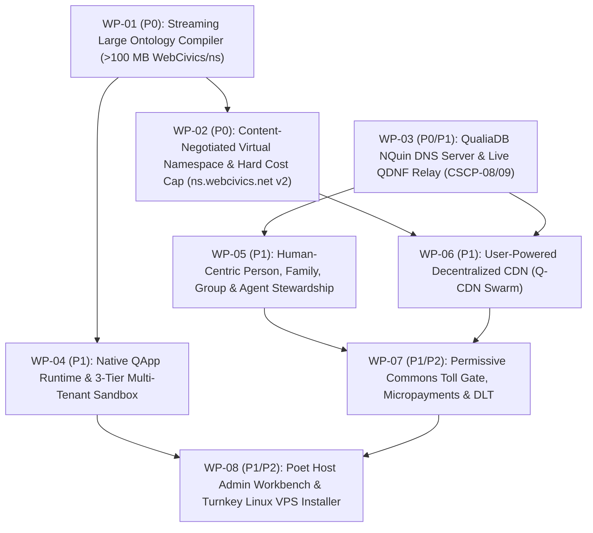

# Webizen & QualiaDB Human-Centric VPS Hosting Platform (`webizen-host`) — Master Implementation Plan

**Program ID:** `IMPL-WEBIZEN-VPS-0.0.40`  
**Specification Baseline:** [`webizen_qualiadb_vps_hosting_specification.md`](../webizen_qualiadb_vps_hosting_specification.md) & [`project definitions.md`](../project%20definitions.md)  
**Codebase Baseline:** QualiaDB `0.0.40-dev` (`c:\github\qualiaDB`), Qualia App Framework (`c:\github\rust-app-framework`), and `webizen-host` (`c:\github\webizen-host`)  
**Last Updated:** 2026-10-26  

---

## 1. Purpose & Architectural Scope

This directory (`dev-docs/implementation-plan/`) translates the **Webizen & QualiaDB Human-Centric VPS Hosting Platform (`webizen-host`)** specification into actionable, module-level engineering plans across eight sequential Work Packages (`WP-01` through `WP-08`).

The platform serves two unified deployment topologies from a single Rust workspace and crate boundary:
1. **Mode A — Standalone Human-Centric VPS Host (`qualia-cli host init --profile=vps-human-centric`)**: A full cPanel/WHM replacement and native QualiaDB/Webizen application server running on commodity Linux VPS instances (`:4242` daemon, `:443` HTTPS/QUIC, `:53`/DoH/DoT/DoQ `NQuin` DNS, W3C Solid LDP pod bridge, and cold-path ontology compiler).
2. **Mode B — Online Extension Relay for Local `webizen-desktop` / `qualiadb` (`:8080` ↔ `:4242`)**: Cryptographically paired via `crates/qualia-peer` (`PeerHost::pair` with post-quantum ML-KEM-768 + Ed25519 over `SocialWebNet` WireGuard or CSCP WSS/HTTP2 capsules), enforcing strict **"Church & State" Vault Separation** (`TheWebizenAgent` / Sanctuary Keep strictly on local hardware to protect *Freedom of Thought*; `PermissiveCommonsTech` shared state and client-encrypted `.q42j` Shamir backups on the VPS).

---

## 2. Mandatory Terminology & Immovable Engineering Rules

### 2.1 Human-Centric & International Human-Rights Nomenclature (No "Sovereign" Terminology)
All documentation, source code identifiers, CLI flags, ontology predicates, and UI copy across `webizen-host` and `qualiaDB` **must strictly avoid** the terms `sovereign`, `sovereignty`, or `self-sovereign`:
- **Why:** Natural persons and their dependents (such as infants, children, or persons supported under guardianship and legal capacity frameworks) are bearers of **human rights, human dignity, legal capacity, and agency** under international human-rights instruments ([OHCHR Core International Human Rights Instruments](https://www.ohchr.org/en/instruments-listings))—not "sovereigns".
- **Normative Replacements:**
  - Use **Human-Centric**, **Personal & Family Stewardship**, **Human Agency**, **Guardianship & Capacity Semantics** (`GuardianshipRelations`, `modalities/capacity.rs`), **Cooperative Quorum Stewardship**, **Sanctuary Keep** (*Freedom of Thought*), **Relationship-Scoped Mail**, and **Human-Centric / Commons DLT**.
  - Respect the foundational Webizen invariant: *"Natural persons are not identity assets; instruments are not peers"* (`core-ontologies/agent-accountability.n3`).

### 2.2 QualiaDB Immovable Architectural Rules (`AGENTS.md` §0, §0-A, §0-B)
Every module built or extended for `webizen-host` must honour the QualiaDB engine invariants:
1. **Two-Tier Zero-Heap Contract (`AGENTS.md` §0-A)**:
   - **Tier 1 (`HotZeroHeap`)**: Per-packet DNS resolution (`net/dns/`), range-slice lookups (`range_volume.rs`), deontic/SHACL policy evaluation (`SlgArena`), and metering gates (`meters.rs`) allocate **zero heap memory** (`no Vec/String/Box`), operating over caller-supplied `&mut [T]` buffers and 48-byte `NQuin` slices.
   - **Tier 2 (`ColdBounded`)**: One-shot streaming ontology compilation (`>100 MB` `WebCivics/ns`), OWL-to-SHACL uplift, and `.q42` v4 / `QBDL` `.hmc` packaging run outside `SlgArena` under an explicit caller-selected byte budget (default **256 MiB** cold arena) and **fail closed** on exhaustion rather than crashing the VPS OS.
2. **48-Byte `NQuin` Universal ABI & `q_hash()`**: All semantic quads, DNS records, and ledger receipts fit the 48-byte `NQuin` layout; all IRIs use compile-time or ingest-time 64-bit FNV-1a `q_hash()` with 60-bit masked lexicon tokens (`Q42LEX v4`).
3. **42 MiB Sentinel Arena (`SlgArena`)**: Multi-tenant logic sandboxes isolate per-tenant reasoning inside deterministic 42 MiB `SlgArena` cells with non-recursive evaluators.
4. **Library Structure & Temporary-Artifact Hygiene (`AGENTS.md` §0-B)**:
   - New capabilities are directory-backed libraries (`mod.rs` routing + focused implementation files `< 500` lines).
   - Staging and compilation scratch directories use bounded `tempfile::TempDir` with RAII cleanup and explicit promotion of verified `.q42` / `.hmc` outputs into content-addressed storage.
5. **SHACL-First Non-Thing Rule**: Natural persons (`NaturalAgent`), kinship, human relations, and living ecological entities are `rdfs:Class` + SHACL/ShEx and **must never subclass `owl:Thing`**.

---

## 3. Six Core QualiaDB Stack Gaps Closed by `webizen-host`

Implementing `webizen-host` directly upgrades `qualia-core-db` and `qualia-client-core` by closing six concrete repository gaps:

| # | QualiaDB Repository Gap | Target Locus in `c:\github\qualiaDB` | Closed By Work Package |
|---|---|---|---|
| **1** | **`CSCP-08` & `CSCP-09` Public Internet Qualification** (currently `false` on `webizen.au/qdnf.html` awaiting a live second host URL) | `crates/qualia-peer`, `net/qdnf/` | [WP-03](./WP-03-nquin-dns-and-qdnf-relay.md) |
| **2** | **`FLAG_PAYLOAD_CATALOGUE` (`0x0080`, ADR 0014)** stub in `.q42` volume writer/reader | `crates/qualia-core-db/src/q42/q42_volume.rs`, `bundle/cbor_ld_manifest.rs` | [WP-01](./WP-01-large-ontology-streaming-compiler.md) |
| **3** | **`owl/materialize.rs` & `owl/shacl_convert.rs`** currently `Library-only` (not wired into production ingest) | `crates/qualia-core-db/src/modalities/logic/owl/`, `qualia-cli/src/ingest/` | [WP-01](./WP-01-large-ontology-streaming-compiler.md) |
| **4** | **`mock_network_fetch` in `net/fetch_10d.rs`** using mock transport instead of live QPR/HTTP range fetches | `crates/qualia-core-db/src/net/fetch_10d.rs` | [WP-06](./WP-06-user-powered-decentralized-cdn.md) |
| **5** | **`derive_lane_key` in `identity/agency.rs`** using single-pass SHA-256 instead of Argon2id + HKDF | `crates/qualia-core-db/src/identity/agency.rs`, `specialized_libs/cryptographic_library` | [WP-05](./WP-05-human-centric-stewardship-groups-and-agents.md) |
| **6** | **In-memory `modalities/value_flow.rs` pools** not yet persisted to durable `.q42j` journals for auto-sunset | `crates/qualia-core-db/src/modalities/value_flow.rs`, `q42/journal.rs` | [WP-07](./WP-07-permissive-commons-micropayments-and-dlt.md) |

---

## 4. Work Package Index & Dependency Graph

### Detailed Work Package Documents in This Directory

1. [**`WP-01-large-ontology-streaming-compiler.md`**](./WP-01-large-ontology-streaming-compiler.md) — **P0**: Bounded 256 MiB streaming compiler for `>100 MB` `WebCivics/ns`, `IngestMode::Complete` + `Q42LEX v4`, SHACL-first non-`owl:Thing` uplift, `FLAG_PAYLOAD_CATALOGUE` (`0x0080`), and `.q42` v4 / `QBDL` `.hmc` / `.vibe` chunk packaging.
2. [**`WP-02-virtual-namespace-and-cost-cap.md`**](./WP-02-virtual-namespace-and-cost-cap.md) — **P0**: Zero-allocation HTTP/2 & HTTP/3 content-negotiated Virtual Namespace Server (`ns.webcivics.net` v2), 40 KiB `QualiaSuperBlock` range serving, and `meters.rs` hard monthly/daily egress byte and dollar circuit breakers.
3. [**`WP-03-nquin-dns-and-qdnf-relay.md`**](./WP-03-nquin-dns-and-qdnf-relay.md) — **P0/P1**: Authoritative & recursive 48-byte `NQuin` DNS server (`:53`, DoH, DoT, DoQ), `QPolicy` deontic split-horizon DNS firewall, bitemporal `.q42j` DNS archive, Dual-Stack QDNF routing, and live two-host `CSCP-08` / `CSCP-09` Internet qualification.
4. [**`WP-04-native-qapp-runtime-and-three-tier-sandbox.md`**](./WP-04-native-qapp-runtime-and-three-tier-sandbox.md) — **P1**: `HostSandboxManager` for Tier 1 VibeScript (`VBC1` + 42 MiB `SlgArena`), Tier 2 WASM QApps (`qualia-app-contract` `SDK-01..10`), Tier 3 W3C Solid LDP Pods (`qualia-solid-bridge`) + Linux/eBPF containers, and 3D/10D `.10d`/`.hmc` + agentic DAG hosting.
5. [**`WP-05-human-centric-stewardship-groups-and-agents.md`**](./WP-05-human-centric-stewardship-groups-and-agents.md) — **P1**: Who-Plane (`NaturalAgent`) ≠ Handle-Plane (`DNI`/DNS) separation, `Collapse Detector`, Argon2id + HKDF lane keys, `:8080` ↔ `:4242` `PeerHost::pair` with Sanctuary Keep separation, and Single Person, Family (`GuardianshipSemantics`), Cooperative (`M-of-N` quorum), and Governed Agent stewardship modes.
6. [**`WP-06-user-powered-decentralized-cdn.md`**](./WP-06-user-powered-decentralized-cdn.md) — **P1**: Three-Layer User-Powered Decentralized CDN (`Q-CDN`), `<10 KiB` signed Root Index, Cooperative VPS Mirrors, `webizen-desktop` `:4242` WebTorrent seeders, Browser OPFS + WebRTC swarm, real `net/fetch_10d.rs` range transport, and automatic HTTP 307 swarm offload.
7. [**`WP-07-permissive-commons-micropayments-and-dlt.md`**](./WP-07-permissive-commons-micropayments-and-dlt.md) — **P1/P2**: Two-Loop Permissive Commons (`value_flow.rs`) persisted in `.q42j`, HTTP `402` commercial toll gate (0% for Natural Persons & Humanitarian ICT), automatic `10x` Commons Sunset, multi-blockchain settlement adapters (`XEC`, `XRPL`, `USDC`, `BTC/Lightning`, `ILP-STREAM`), multi-exchange coin swap connectors (`ExchangeSiteConnector`), and an energy-cheap, post-quantum-secure (`ML-DSA-65` / `SLH-DSA` + zero-PoW BFT) native ledger.
8. [**`WP-08-poet-admin-workbench-and-turnkey-installer.md`**](./WP-08-poet-admin-workbench-and-turnkey-installer.md) — **P1/P2**: Human-Centric Poet Host Admin Workbench organized around Webizen's Six Life Domains (`Memory · Relations · Care · Practice · World · Instruments`) with full cPanel feature parity, plus the 1-command `qualia-cli host install` Linux VPS installer.
9. [**`WP-09-vps-production-deployment-swarm-plan.md`**](./WP-09-vps-production-deployment-swarm-plan.md) — **P0**: Live wire protocols for Linux VPS deployment: RFC 1035 UDP DNS (`wire_dns.rs`), RFC 8555 ACME `HTTP-01`/`DNS-01` + `WebizenID-TLS` (`acme_tls.rs`), RFC 5321 TCP SMTP + DKIM + `MaildirSpool` (`smtp_mail.rs`), Git Smart HTTP (`info/refs`, `git-receive-pack`) + bare `.git` object store (`git_smart_http.rs`), `HostPersistentState` CBOR-LD (`0xD90501`) persistence (`vps_deployment.rs`), and `webizen-hostd` binary (`src/bin/webizen-hostd.rs`).
10. [**`WP-10-full-vps-readiness-and-live-control-plane-plan.md`**](./WP-10-full-vps-readiness-and-live-control-plane-plan.md) — **P0**: Unified shared-state multi-protocol server (`HTTP + UDP DNS + TCP SMTP`), `StewardSessionGuard` (`did:qi` HMAC cookie + CSRF gate) & zero-heap `IpRateLimiterRing` (`auth_and_session.rs`), W3C Solid LDP `/solid/*` + IPFS `/ipfs/*` + WebTorrent `HTTP 206` `/torrent/webseed/*` (`solid_ipfs_webseed.rs`), Zero-JS `<form method="post" action="/cpanel/...">` across all 10 Control Panel pages (`assets/index.html`, `persona_ui.rs`), `Caddyfile`/`Containerfile`/`backup-cron.sh` deployment artifacts, and 12-point `--verify-vps-readiness` self-test (`http_daemon.rs`).
11. [**`WP-11-aaa-vibe-3d-studio-and-final-vps-hardening-plan.md`**](./WP-11-aaa-vibe-3d-studio-and-final-vps-hardening-plan.md) — **P0**: AAA Film-Level VibeScript 3D Asset & Scene Production Engine (`vibe_3d_studio.rs` powered by `vibe::animation` PGA $\mathcal{G}_{3,0,1}$ motors, `vibe::physics` PBR materials, volumetric SVG rendering, and `QBDL` `.hmc` packaging), VibeScript UI/UX & Multi-Modal Presentation Sheaf Studio (`vibe_ux_toolkit.rs` powered by `vibe::presentation` Visual/Haptic/Auditory/Braille sheaves and `vibe::web_runtime` composite widgets), 12-Module AAA Holographic Control Panel (`assets/index.html`), and Final Internet-Facing VPS Protocol Hardening (RFC 8484 DoH `/dns-query`, ACME `HTTP-01`, Sanctuary Keep `/sanctuary/*`, `/commons/settle`, `/healthz`, `/metrics`, and 16-point `--verify-vps-readiness`).
12. [**`WP-12-production-vps-supervisor-jmap-git-clone-and-snapshot-plan.md`**](./WP-12-production-vps-supervisor-jmap-git-clone-and-snapshot-plan.md) — **P0**: Concurrent Multi-Protocol VPS Supervisor (`multi_protocol_supervisor.rs` supervising HTTP/1.1 + dynamic hot-reloaded UDP DNS + dynamic hot-reloaded TCP SMTP + hardware-loopback Sanctuary Keep), Live Zero-JS SSR State Hydration (`live_ssr_hydration.rs`), JMAP-over-CBOR-LD & Maildir Inbox/Cur/Sent API + Outbound DKIM Submission (`jmap_maildir_api.rs`), Git Smart HTTP `git-upload-pack` (`git clone`/`fetch`) + ChaCha20-Poly1305 Encrypted Full-VPS Snapshot & Restore (`.q42snap` in `vps_backup_and_git_pack.rs`), CLI management flags (`--doctor`, `--snapshot-backup`, `--restore-backup`, `--add-domain`, `--add-mail-alias`), and 24-Point Live VPS Readiness Verifier.
13. [**`WP-13-zero-stub-ed25519-x509-live-gates-and-full-cpanel-execution-plan.md`**](./WP-13-zero-stub-ed25519-x509-live-gates-and-full-cpanel-execution-plan.md) — **P0**: Zero-Stub Remediation: Pure-Rust Asymmetric Public/Private Key Signatures & ASN.1 DER X.509 v3 / PKCS#8 Certificate & Key Generator (`ed25519_and_x509.rs`), Public-Key-Verified TLS Bundles (`acme_tls.rs`) & DNS `_domainkey` DKIM Signatures (`smtp_mail.rs`), Live `IpRateLimiterRing` (`429`) & `StewardSessionGuard` (`401`) Enforcement + Real `/cpanel/wallet/swap` & `/cpanel/ontologies/sparql` Execution + `Accept: text/html` SSR Response (`http_daemon.rs` & `http_routes_ext.rs`), and Multi-Object Git `PACK` v2 Enumeration + `--ingest-ttl` CLI Compiler (`vps_backup_and_git_pack.rs` & `bin/webizen-hostd.rs`).
14. [**`RETAIL-READINESS-AUDIT-AND-PHASED-SWARM-PLAN.md`**](./RETAIL-READINESS-AUDIT-AND-PHASED-SWARM-PLAN.md) — **Comprehensive Retail-Readiness Audit Report & Phased Swarm Plan (`WP-14`–`WP-25` / Phases 1–12 Completed & Verified)**: Documents the completed `WP-14` through `WP-19` core interoperability baseline plus the `WP-20` through `WP-25` (`Phases 7–12`) retail polish & hardening swarm execution closing `GAP-R1` through `GAP-R8` (`77/77` workspace tests passing across all `9` crates, `46` `.rs` files all strictly `< 500` lines, and `0` forbidden nomenclature occurrences).

---

## 5. End-to-End Release Gate Criteria (`GA-17` / `SDK-01..10`)

No Work Package may be marked complete until its entire end-to-end chain is verified by automated tests and live host receipts:
$$\text{Producer} \longrightarrow \text{Serialized Container (`.q42` / `.hmc` / `VBC1` / `.q42j`)} \longrightarrow \text{Bounded Admission} \longrightarrow \text{Runtime Caller} \longrightarrow \text{Verified Acceptance Receipt}$$
